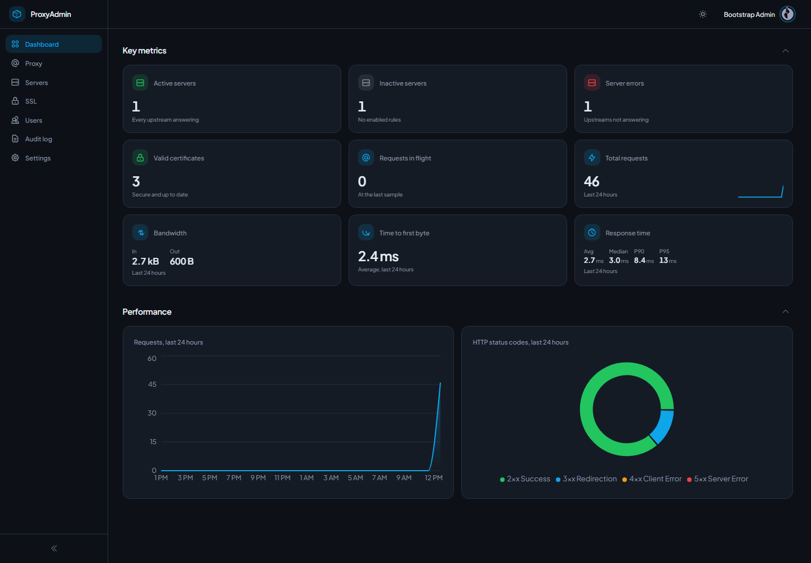
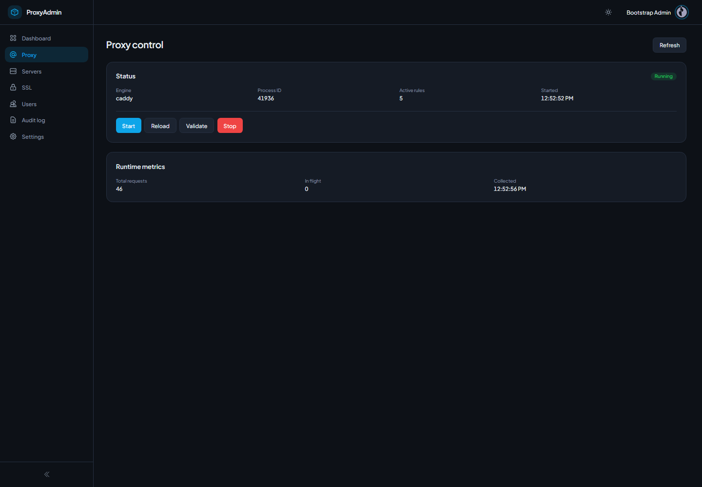
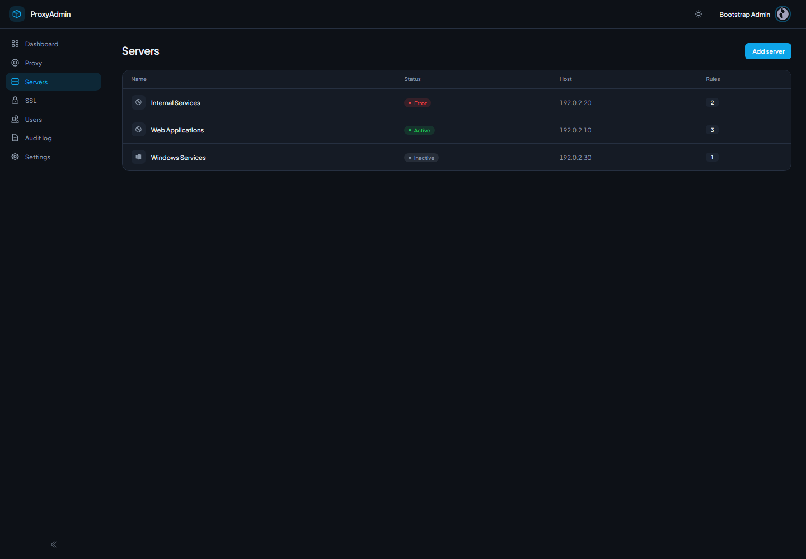
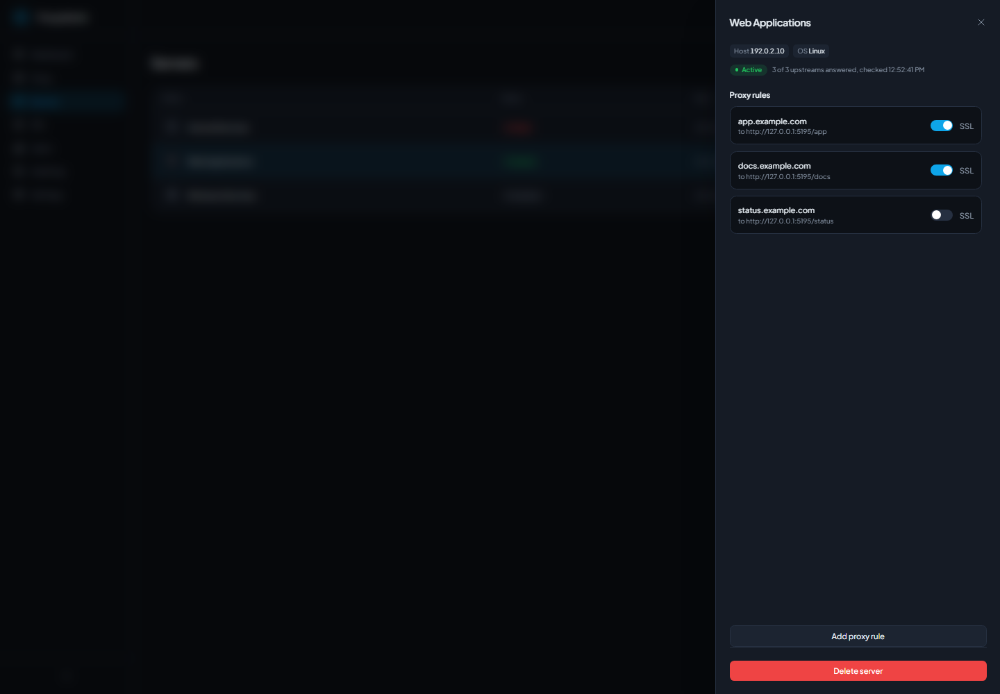
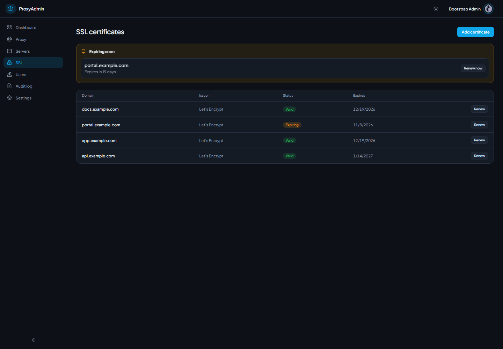
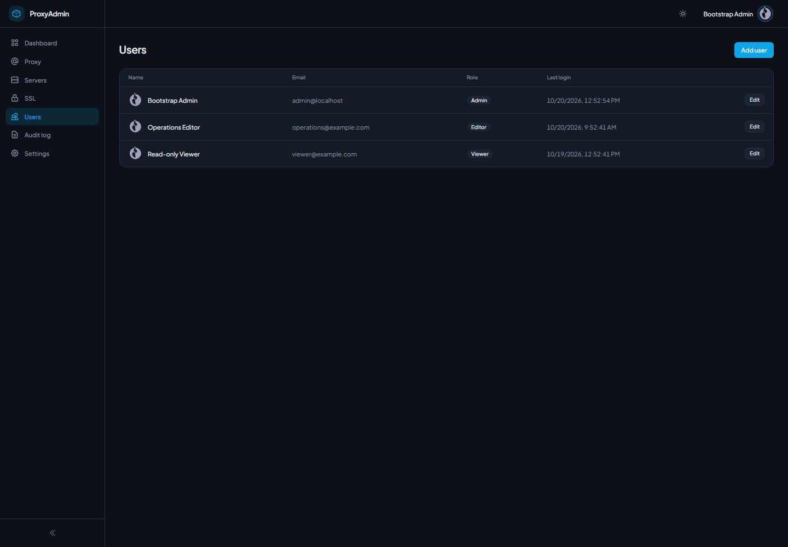
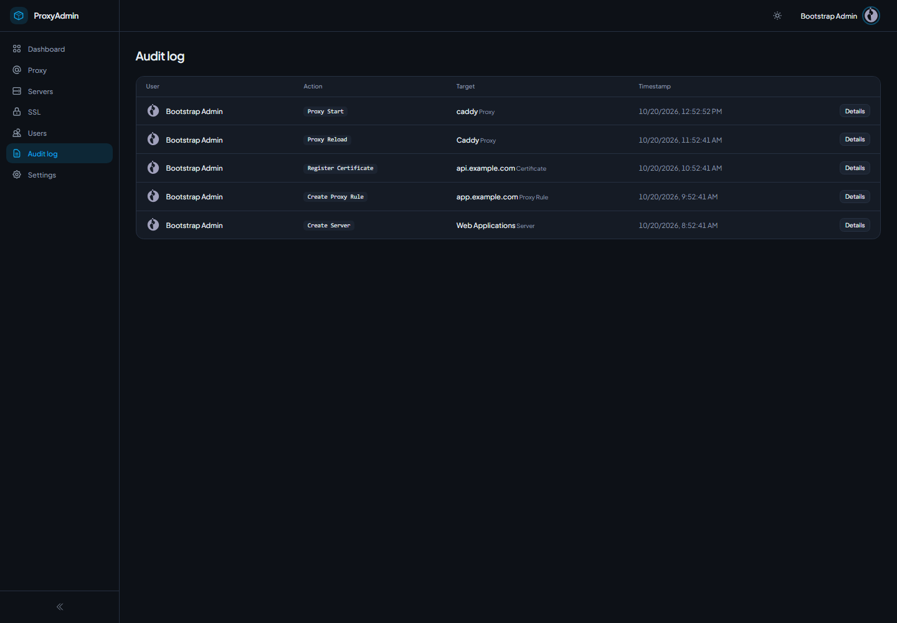

# SSLReverseProxy

**A security-first control plane for a [Caddy](https://caddyserver.com) reverse
proxy.** It pairs a React admin dashboard with an ASP.NET Core (.NET 10) service
that starts, stops, and configures the proxy — managing servers, proxy rules, and
ACME-issued TLS certificates. Security is the design center rather than an
afterthought: the API authenticates with hashed API keys or mutual TLS, enforces
deny-by-default role-based access on every action, re-validates every proxy
upstream server-side to block SSRF, supports per-route IP allow/deny, and records
an append-only audit trail with config snapshots and one-call rollback.

## What's here

- **`/` (React + TypeScript + Vite)** — the admin UI: dashboard, servers, proxy
  rules, SSL certificates, users, and audit log.
- **[`server/`](server/README.md) (ASP.NET Core / .NET 10)** — the control plane
  that owns authentication, authorization, secret custody, and the proxy
  lifecycle. See its README for the full endpoint and security reference.
- **[SECURITY.md](SECURITY.md)** — the security model and threat boundaries.

> **Status:** the backend control plane is implemented and tested, and the React
> app talks to it via [`services/apiClient.ts`](services/apiClient.ts) —
> sign in with an API key (auto-claimed on a first dev run).

## Screenshots

Screenshots show the application running against the control plane's Development demo data (`Seed:Demo`), with example domains and documentation IP addresses. The dashboard's traffic is what Caddy served to test requests during the capture.



| Proxy control | Servers |
| --- | --- |
|  |  |

| Proxy rules | SSL certificates |
| --- | --- |
|  |  |

| Users | Audit log |
| --- | --- |
|  |  |

## Run Locally

**Frontend** (prerequisites: Bun 1.4 and Node.js 22.12 or later)

1. `bun install`
2. `bun run dev` — or `bun run build && bun run preview` for a production build (which injects the Content-Security-Policy). Both forward `/api` to the control plane at `http://localhost:5195`; `SSLRP_API_TARGET` changes the target.
3. `bun run test` runs the Vitest suite.
4. `bun run e2e` runs the Playwright tests. They start the control plane with demo data on a new database, build and preview the UI, and check every view in both themes, server statuses and live status updates. With `SSLRP_TEST_CADDY` naming a Caddy built with caddy-ratelimit ([server/README.md](server/README.md#caddy)), they also start the proxy, check plaintext and TLS hosts on its HTTP port, and check the dashboard shows the traffic it served. They need the .NET 10 SDK and free ports 5195 and 4173, plus 8780, 8743 and 2019 for Caddy; install the browser once with `bunx playwright install chromium`.
5. `bun run screenshots` retakes `docs/screenshots` from the same demo data, with proxy traffic when `SSLRP_TEST_CADDY` is set.

**Backend** (prerequisite: .NET 10 SDK)

```bash
cd server
dotnet test          # 179 tests
dotnet run --project src/SslReverseProxy.Api
```

The first backend run seeds a bootstrap admin and prints a one-time API key to the log. In development you don't need to copy it: the UI claims it automatically on first load via `GET /api/bootstrap-key` (Development + loopback only, single claim) and signs you in. Run it with `Seed__Demo=true` to fill a new Development database with sample servers, rules, certificates, users and audit entries. Full details in [server/README.md](server/README.md).
